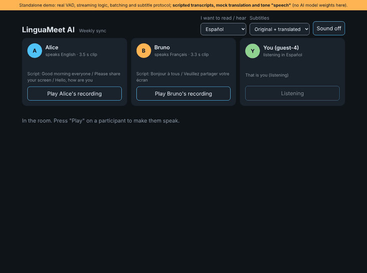
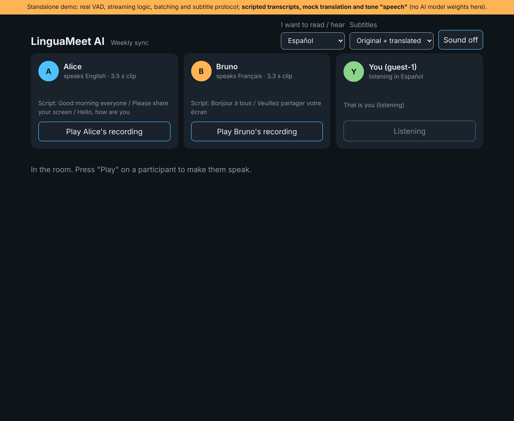
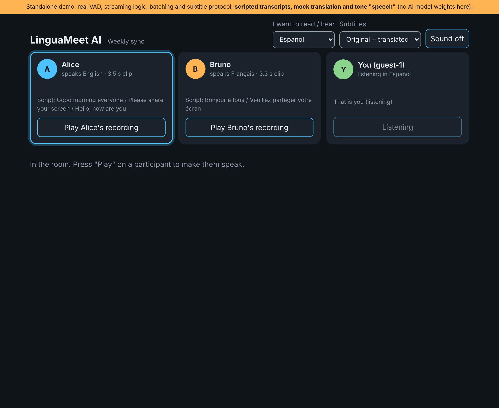
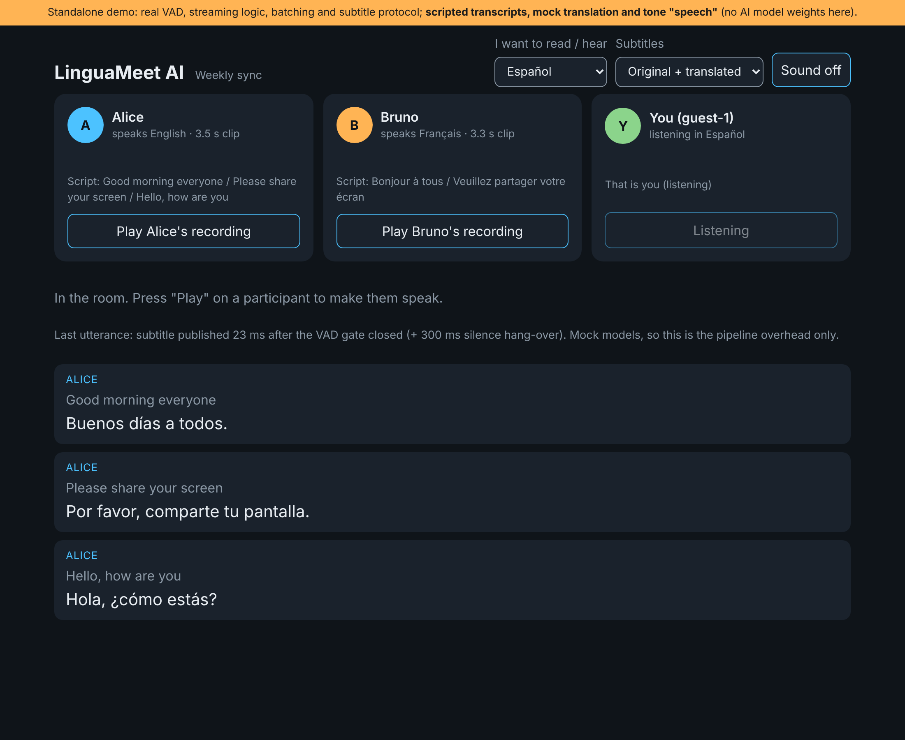
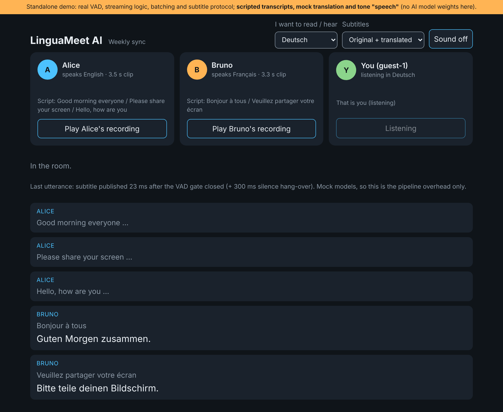
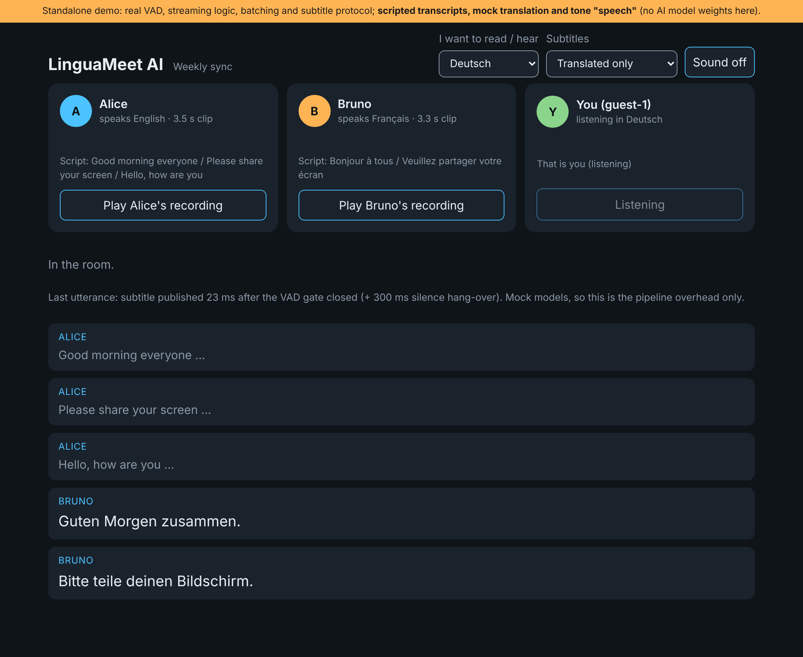
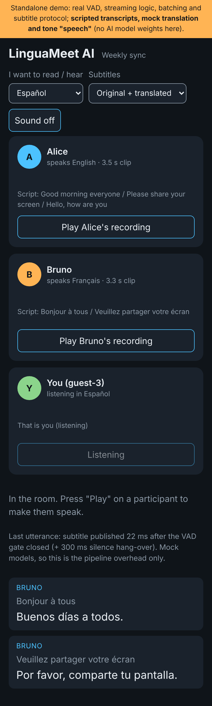

# LinguaMeet AI

Real-time multilingual meeting platform: **LiveKit audio -> Silero VAD -> streaming Whisper (faster-whisper, LocalAgreement-2) -> NLLB-200 (CTranslate2) -> TTS**, with subtitles over the LiveKit data channel.


## Try it

### A. Standalone demo room (no LiveKit, no model weights)

```bash
pip install -e ".[dev]"        # includes aiohttp
python -m meetdemo.server      # or: make demo   -> open http://127.0.0.1:8765
```



A meeting room with two scripted participants (Alice speaks English, Bruno speaks French, each a real recording) and you as a listener.
Press "Play" on a participant: the tile lights up from the **real Silero VAD**, subtitles stream in through the **real pipeline and subtitle protocol**
and are rendered by the **real client module**, translated for the language you pick, with (mock) tone audio if you enable sound.

> **Honest labelling.** There are no model weights in the build sandbox, so the transcripts are *scripted* (replayed over the real recordings),
> translation is a small phrase table (other pairs pivot through English) and "speech" is tones. The banner in the page says so too.
> Tests: `pytest meetdemo`. Regenerate the media: `python scripts/demo/capture_live.py`.

| | | |
|---|---|---|
|  |  |  |
| Lobby | Alice speaking (VAD) | Spanish subtitles |
|  |  |  |
| French speaker, German listener | Translated only | Mobile |

The client module on its own (replaying recorded packets) is in `docs/screenshots/client-only/`.

### B. Real meeting with LiveKit and the real models

Quick path: `make setup`, then `make gateway` and `make web` in two terminals, then `make tokens` (`make help` lists all targets).
Step by step in **[docs/RUN_FOR_REAL.md](docs/RUN_FOR_REAL.md)**.
This path needs model downloads from Hugging Face and has **not been run** in the build sandbox (no network access to it).

See `TODO.md` for build status, `REFERENCES.md` for sources, `docs/` for the research sprint and project description.

## Layout
- `shared/` config (pydantic-settings), language tables, audio helpers, message types
- `gateway/` LiveKit gateway (per-participant VAD gating, tokens, subtitle publishing)
- `services/vad|asr|translation|tts/` pipeline stages, each with its own `test_*.py`
- `pipeline/` meeting orchestrator and `python -m pipeline.server` entry point
- `client/` web client (`index.html`, `subtitles.js`, `app.js`, Jest tests), `tests/` shared and end-to-end tests, `scripts/` tooling (NLLB conversion, benchmarks)
- `BENCHMARKS.md` measured latencies, `REPORT.md` design report with citations

## Run the tests
```bash
pip install -e '.[dev]'
pytest                      # unit tests (mock backends where weights are needed)
ASR_TEST_MODEL=tiny pytest services/asr -k real                       # real Whisper (needs weights)
NMT_TEST_MODEL_DIR=models/nllb-200-distilled-600M-ct2 pytest services/translation -k real
```
JS client tests: `cd client && npm install && npx jest`. Benchmarks: `python scripts/benchmark.py --runs 5` (add `--real asr,nmt,tts` with weights).

Run a meeting: start `livekit-server --dev`, set `LIVEKIT_API_KEY/SECRET`, run `python -m pipeline.server run --room demo`, mint tokens with `python -m pipeline.server token --room demo --identity alice`, and serve `client/` (for example `python -m http.server -d client`).

Convert NLLB once with `scripts/convert_nllb.sh`. Licenses to be aware of: NLLB weights CC-BY-NC-4.0, XTTS model CPML (non-commercial), Piper GPLv3.
